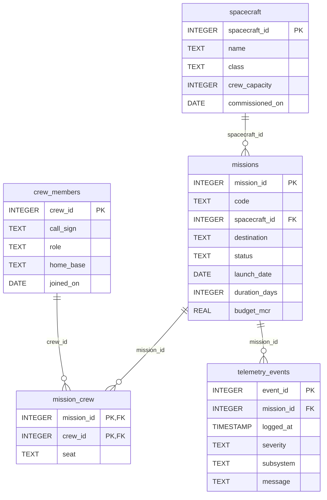

# mcp-sqlite-explorer

**Hand Claude the keys to your SQLite database. Keep the steering wheel locked.**

[](https://github.com/TGabeCar/mcp-sqlite-explorer/actions/workflows/ci.yml)
[](LICENSE)
[](https://www.python.org/)
[](https://modelcontextprotocol.io)

`mcp-sqlite-explorer` is a [Model Context Protocol](https://modelcontextprotocol.io) server that lets
Claude (or any MCP client) list tables, read schemas, sample rows, draw an ER diagram and run SQL
against a SQLite file. It reads everything and writes nothing: read-only is enforced in four separate
layers, and the test suite tries to break every one of them.

---

## Talk to your database

Point it at the bundled demo (an invented space-agency mission log) and just ask. The tool output
below is real, from `examples/mission_control.db`:

> **You:** Which spacecraft flies the most missions, and did anything go seriously wrong out there?
>
> **Claude:** *calls* `list_tables`, *then* `query`:
> ```sql
> SELECT s.name, COUNT(*) AS missions
> FROM missions m JOIN spacecraft s USING (spacecraft_id)
> GROUP BY s.name ORDER BY missions DESC LIMIT 3
> ```
> | name | missions |
> |---|---|
> | Pale Lantern | 7 |
> | Basalt Moth | 6 |
> | Orrery Wren | 5 |
>
> *then* `query`:
> ```sql
> SELECT m.code, e.logged_at, e.subsystem, e.message
> FROM telemetry_events e JOIN missions m USING (mission_id)
> WHERE e.severity = 'critical' ORDER BY e.logged_at
> ```
> | code | logged_at | subsystem | message |
> |---|---|---|---|
> | Gamma-106 | 2036-03-26 08:24:00 | life support | Loss of signal for 12 minutes |
> | Cosmo-122 | 2036-06-16 15:48:00 | comms | Main engine shutdown earlier than planned |
> | Helix-107 | 2037-02-27 19:25:00 | thermal | Main engine shutdown earlier than planned |
>
> The lander **Pale Lantern** is the workhorse with 7 missions. Out of 106 telemetry events only
> 3 are critical: a 12-minute loss of signal on Gamma-106 and two early engine shutdowns.
>
> **You:** Great. Now delete the scrubbed missions, they're clutter.
>
> **Claude:** *calls* `query` with `DELETE FROM missions WHERE status = 'scrubbed'`
> ```
> Error executing tool query: Only SELECT, WITH, EXPLAIN and read-only PRAGMA statements are allowed (got DELETE).
> ```
> No can do: this server is read-only, so the 5 scrubbed missions stay put. If you want them gone,
> that's a job for your own migration tooling.

That last refusal is the point. You can let an agent roam a database snapshot without wondering what
it might decide to "tidy up".

## Tools

| Tool | What it does |
|---|---|
| `list_tables()` | Every table and view, with its type and row count. |
| `describe_table(name)` | Columns, types, nullability, defaults, primary key, row count, indexes and foreign keys. |
| `query(sql, limit=100)` | Runs **one** read-only statement (`SELECT`, `WITH`, `EXPLAIN`, or an allowlisted read-only `PRAGMA`) and returns a compact markdown table. `limit` is clamped to 1..1000. |
| `sample_rows(table, n=5)` | First `n` rows of a table or view (max 50). |
| `schema_diagram()` | A Mermaid `erDiagram` of every table and foreign key. |

| Resource | What it holds |
|---|---|
| `schema://tables` | Every table and view with its `CREATE` statement, as markdown. |

Every tool is advertised with MCP's `readOnlyHint: true` and `destructiveHint: false` annotations, so
clients that honour them know these tools cannot change anything.

## The demo database

`examples/make_demo_db.py` builds a synthetic mission-control database from a fixed random seed
(every craft, call sign and event is made up). The committed `examples/mission_control.db` is about
60 KB. This diagram is the verbatim output of `schema_diagram()` on it:



There is also a `mission_summary` view. Views show up in `list_tables` but are not drawn as entities.

## Install

Requires Python 3.10+. The only runtime dependency is the official [`mcp`](https://pypi.org/project/mcp/) Python SDK (1.x).

```bash
git clone https://github.com/TGabeCar/mcp-sqlite-explorer.git
cd mcp-sqlite-explorer
python -m venv .venv
# macOS/Linux: source .venv/bin/activate    Windows: .venv\Scripts\activate
pip install -e .
```

That gives you an `mcp-sqlite-explorer` command inside the venv. It speaks MCP over stdio.

```bash
mcp-sqlite-explorer examples/mission_control.db                    # path as an argument
SQLITE_DB_PATH=examples/mission_control.db mcp-sqlite-explorer     # or via the environment
python -m mcp_sqlite_explorer examples/mission_control.db          # module form works too
```

The argument wins over `SQLITE_DB_PATH`. If neither is given, or the file does not exist, it exits
with a clear message. It never creates an empty database by accident.

## Configure your client

### Claude Code

```bash
claude mcp add sqlite-explorer -- mcp-sqlite-explorer /absolute/path/to/your.db
```

Or pass the path through the environment:

```bash
claude mcp add sqlite-explorer -e SQLITE_DB_PATH=/absolute/path/to/your.db -- mcp-sqlite-explorer
```

If the venv is not active when Claude Code starts, use the full path to the command
(`/path/to/.venv/bin/mcp-sqlite-explorer`).

### Claude Desktop

Add this to `claude_desktop_config.json` (Settings > Developer > Edit Config):

```json
{
  "mcpServers": {
    "sqlite-explorer": {
      "command": "/absolute/path/to/.venv/bin/mcp-sqlite-explorer",
      "args": ["/absolute/path/to/your.db"]
    }
  }
}
```

On Windows the command is `C:\\path\\to\\.venv\\Scripts\\mcp-sqlite-explorer.exe`. Use absolute
paths: desktop apps do not start inside your virtualenv. Restart Claude Desktop after editing.

## Security model

Defense in depth: each layer below blocks writes on its own, and
[`tests/test_security.py`](tests/test_security.py) switches the layers off one at a time to prove it.

1. **Read-only file handle.** The database is opened through a SQLite URI with `mode=ro`, so the
   engine refuses to write to the file at all. A missing file is an error, never a fresh empty database.
2. **`PRAGMA query_only = ON`** on every connection.
3. **An authorizer callback** (`sqlite3.Connection.set_authorizer`) that allows only reads. It denies
   `INSERT`/`UPDATE`/`DELETE`, every `CREATE`/`DROP`/`ALTER`, `ATTACH`/`DETACH`, transactions,
   `load_extension`, and any `PRAGMA` outside a small read-only allowlist (`table_info`,
   `index_list`, `foreign_key_list`, `user_version` and friends). `PRAGMA writable_schema` and
   `PRAGMA query_only = OFF` never get through.
4. **A static statement check** before the SQL reaches SQLite. Comments, string literals and quoted
   identifiers are blanked out first (so `'please DELETE me'` or a column named `"update"` is fine).
   Then the query must be a **single** statement starting with `SELECT`, `WITH`, `EXPLAIN` or `PRAGMA`,
   with no write or admin keyword anywhere (so `WITH x AS (...) DELETE ...` is caught), and a `PRAGMA`
   must be allowlisted and must not assign with `=`.

**Limits that keep answers small and agents unstuck:**

| Limit | Value |
|---|---|
| Rows from `query` | default 100, hard max 1000; the reply says when more rows exist |
| Rows from `sample_rows` | default 5, hard max 50 |
| Characters per cell | 200, then truncated with `…`; newlines flattened, pipes escaped, BLOBs shown as `<blob N bytes>` |
| Query run time | 5 seconds, then SQLite is interrupted by a progress handler |
| SQL length | 20,000 characters |

Table names given to `describe_table` and `sample_rows` are looked up in `sqlite_master` first and
then quoted, so they cannot smuggle SQL.

**What it does not do:** read-only is not the same as private. Anything in the file can be read by
whoever drives the client, so point it at a database (or a copy) you are happy for the model to see.
There is no per-table or per-column filtering yet; that is on the roadmap.

## Development

```bash
pip install -e ".[dev]"
python -m pytest -q                  # tools, security, and a real in-memory MCP client session
python examples/make_demo_db.py      # rebuild the demo database
```

CI runs the suite on Ubuntu and Windows across Python 3.10, 3.12 and 3.13, plus a
[gitleaks](https://github.com/gitleaks/gitleaks) secret scan over the full history.

```
src/mcp_sqlite_explorer/
  db.py        # all the logic, as plain testable functions
  server.py    # FastMCP wiring and the CLI entry point
examples/
  make_demo_db.py
  mission_control.db
tests/
```

## Roadmap

- [ ] Publish to PyPI so `uvx mcp-sqlite-explorer` just works
- [ ] Table and column allow/deny lists (keep `users.password_hash` out of the model's sight entirely)
- [ ] Several databases in one server, picked by name
- [ ] An `explain_query` tool that turns `EXPLAIN QUERY PLAN` into plain-English index advice
- [ ] Optional CSV/JSON output for `query`
- [ ] A streamable HTTP transport flag

## License

[MIT](LICENSE) © 2026 Gabe
